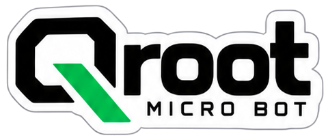
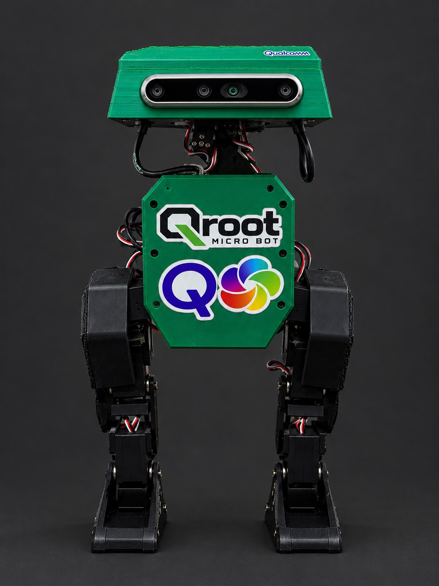

<p align="center">
  
</p>

# Physical AI on Qualcomm: a walking robot on the RB3 Gen 2

This repo is an end-to-end physical AI stack on one Qualcomm board. A **Qualcomm RB3 Gen 2** (QCS6490) runs
everything a small walking robot needs, with no PC or cloud in the loop for control:
- **Sense:** depth and colour from an Intel RealSense D455, and the board's onboard IMU (TDK ICM-42688), read through
  Qualcomm's sensing hub.
- **Act:** a reinforcement-learning walking policy, trained in MuJoCo and run at 50 Hz on the board, driving 14 servos.
- **Interact:** a live dashboard, head-follow, spoken lines and a microphone.

```
 PS4 pad ──BT──┐
               ▼
 RealSense ──USB──►  Qualcomm RB3 Gen 2 (QCS6490, Ubuntu)  ──USB──► Pico bridge ──► servo bus (14× STS3215)
 D455 (head)         act:     RL walking policy, 50 Hz, own core
                     sense:   onboard IMU via the sensing hub, depth + colour
                     interact: dashboard :8080, head-follow, voice
```

| Layer | What runs on the QCS6490 | Where |
|---|---|---|
| Locomotion | RL policy (ONNX) at 50 Hz, real-time priority on the fastest core; loop work 0.75 ms | `robot/jero_walk.py` |
| Balance sensing | onboard ICM-42688 at 200 Hz through Qualcomm's sensing hub | `robot/imu_qsh.py` |
| Perception | aligned depth + colour at 15 fps, nearest-object tracking, head-follow | `brain/eyes.py` |
| Interaction | dashboard in any browser: camera, depth, commands, speech text, path walked | `brain/eyes.py`, `brain/show.py` |
| Voice | spoken lines (ElevenLabs, cached for offline), mic for speech commands | `brain/show.py`, `brain/voice.py` |

Next: move perception models onto the board's Hexagon NPU (QNN), for example person detection.

## The robot: Qroot micro bot

<p align="center">
  
</p>

Qroot is the open-source demonstrator for this stack. It is built on the [Open Duck Mini v2](https://github.com/apirrone/Open_Duck_Mini)
mechanics: 14 Feetech STS3215 servos, with the RealSense in the head and the RB3 Gen 2 in the body.

The code, the Python package (`jero_link`) and the paths on the robot (`~/Jero`, `~/.config/jero`) still use the
robot's earlier name, Jero.

## Branches

| Branch | Robot computer | State |
|---|---|---|
| `main` | Qualcomm RB3 Gen 2 | **Qroot**, active |
| `pi-zero` | Raspberry Pi Zero 2 W | frozen demo build of the Pi version (`robot/demo.sh`) |

## Run it

The steps in order are in [docs/commands/](docs/commands/README.md):
1. Pose.
2. Check the servos.
3. Check the camera.
4. Open the dashboard.
5. Walk without the pad.
6. Walk with the pad.
7. Stand still.

Setup and bring-up details are in [docs/rb3gen2.md](docs/rb3gen2.md).

```bash
git clone https://github.com/dev-ansh-r/Qroot ~/Jero
~/Jero/robot/setup_rb3.sh            # packages, Python env, runtime, policy, link key, Bluetooth, udev
~/Jero/robot/setup_vision.sh         # RealSense + OpenCV
~/Jero/tools/rb3_dryrun.sh           # whole-robot check, nothing moves
~/Jero/robot/jero.sh                 # walk with the PS4 pad (Cross starts/pauses)
```

**E-stop from a terminal on the robot:** `python ~/Jero/tools/estop.py 127.0.0.1`

## Repo layout

```
docs/          RB3 bring-up, command sheets, BOM, printing, wiring, training, link spec, demo day
robot/         walk loop (upstream policy + controller mux), servo IO, IMU drivers, setup scripts
brain/         dashboard (eyes), show controller, voice, expressions, teleop, follow-me
jero_link/     pip package: UDP + HMAC command protocol, client and receiver
training/      GPU server: set up, train, watch in MuJoCo, deploy a policy
tools/         pose, bus and IMU tests, dry run, e-stop, pad test, servo configuration
upstream/      pinned git submodules (read-only): Open_Duck_Mini, _Runtime, _Playground
tests/         hardware-free tests
```

## Development machines

**Laptop**
```bash
git clone --recurse-submodules --shallow-submodules https://github.com/dev-ansh-r/Qroot && cd Qroot
pip install -e jero_link[test] numpy && make test
```

**GPU server (training)**
```bash
git clone --recurse-submodules=upstream/Open_Duck_Playground --shallow-submodules https://github.com/dev-ansh-r/Qroot
Qroot/training/setup_server.sh && Qroot/training/train.sh
```

## Pinned upstream

| Repo | Branch | Commit |
|---|---|---|
| [apirrone/Open_Duck_Mini](https://github.com/apirrone/Open_Duck_Mini) | v2 | `b23317a` (STLs, docs, `BEST_WALK_ONNX_2.onnx`) |
| [apirrone/Open_Duck_Mini_Runtime](https://github.com/apirrone/Open_Duck_Mini_Runtime) | v2 | `376de65` |
| [apirrone/Open_Duck_Playground](https://github.com/apirrone/Open_Duck_Playground) | main | `b9be205` |

Bump a submodule deliberately (`git -C upstream/<repo> checkout <sha>`), then note why in the commit message.

## Credits

The mechanical design, runtime and training environment are by Antoine Pirrone and the Open Duck community
(Open_Duck_Mini is Apache-2.0). Qroot adds the integration layer in this repo.
